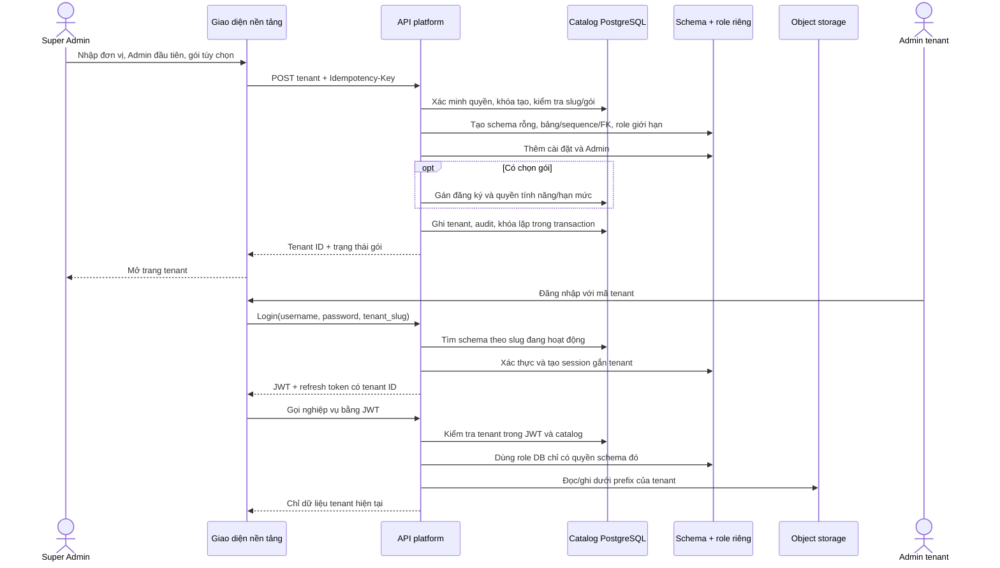

# Contract tenant

Các phần bên dưới giữ nguyên phạm vi và ghi nhận của từng contract, ở các thời điểm khác nhau. Contract tạo tenant và viewer legacy không thay thế cho kiểm chứng runtime hiện tại.

## Nội dung

- [Tạo tenant có dữ liệu độc lập](#creation)
- [Luồng thêm và đăng nhập tenant](#flow)
- [Platform tenant read-only viewer](#viewer)

## Tạo tenant có dữ liệu độc lập

Phạm vi: Platform Super Admin tạo đơn vị, Admin ban đầu và tùy chọn gói. Tenant chưa có gói vẫn đăng nhập/xem gói được nhưng không dùng nghiệp vụ. Không tự chọn gói/tính năng hoặc tạo tài khoản mặc định. Dữ liệu legacy giữ nguyên.

Thiết kế: mỗi tenant mới dùng schema PostgreSQL riêng và namespace object storage riêng. Không thêm một bản ghi tenant rồi trỏ vào dữ liệu legacy. Tên schema do server sinh; body/header không được chọn schema. Login nhận mã tenant, JWT/refresh token ràng buộc tenant; request nghiệp vụ chọn kết nối bằng tenant đã ký trong JWT. Không có public schema trong search_path của kết nối tenant.

`POST /api/v1/platform/tenants` cần `platform.access`, `platform.tenants.read`, `platform.tenants.manage` và active Super Admin được kiểm tra trong DB. Body: tên, slug, thông tin liên hệ, username/tên/email/password Admin, gói tùy chọn. Password tối thiểu 12 ký tự, tối đa 72 byte; không ghi body/password vào audit hoặc response. Slug không trùng và không dùng mã dành riêng. Tạo catalog/schema/Admin/đăng ký/audit trong cùng transaction; lỗi phải rollback toàn bộ. Retry bằng cùng idempotency key phải không tạo tenant thứ hai.

AC:

- Super Admin có quyền thấy nút/biểu mẫu Thêm tenant; người thiếu quyền bị chặn tại API.
- Tạo thành công mở tenant mới, có đúng một Admin; không sao chép dữ liệu khách hàng, công việc, phiên hoặc quyền cấm từ legacy.
- Gói chọn phải tồn tại, còn cho gán và đã cấu hình tính năng; không gán thì trạng thái gói rõ ràng.
- Trùng slug/retry/conflict hiển thị lỗi có thể xử lý; không lộ credential hoặc để lại schema/tài khoản nửa chừng.
- Admin tenant đăng nhập với mã tenant, chỉ xem/sửa dữ liệu schema đó; token/ID/refresh/link file của tenant khác không dùng chéo được, kể cả ID nội bộ bằng nhau.
- Các API platform, viewer, usage, subscription và audit đọc đúng tenant; identity/cache FE dùng organization_id thực tế.
- Schema và prefix storage không xuất hiện trong form/API công khai. Connection pool giới hạn; không ghép identifier từ input người dùng.

Kiểm chứng PostgreSQL thật đã tạo hai tenant có cùng username và ID nội bộ; xác nhận schema role thứ nhất không đọc được bảng thứ hai, không thể `SET ROLE` sang owner, tạo lặp trả cùng tenant, key lặp với body đổi bị từ chối, migration chạy lặp được và test dọn schema/role sau khi chạy. Kiểm thử storage xác nhận prefix tenant và chặn traversal. Go test/vet, FE typecheck/lint/architecture check đã chạy. Chưa chạy xác minh đăng nhập qua trình duyệt với hai tenant trên server local. Migration chỉ bổ sung metadata, role runtime và policy; không chuyển hoặc xóa dữ liệu nghiệp vụ legacy. Sơ đồ: [luồng thêm và đăng nhập tenant](TENANCY.md#flow).

## Luồng thêm và đăng nhập tenant

Tạo schema, Admin, đăng ký, audit và idempotency nằm trong một transaction PostgreSQL. Nếu bước nào lỗi, transaction rollback toàn bộ. Schema và role do server sinh; không nhận chúng từ trình duyệt.

## Platform tenant read-only viewer

Implemented 2026-10-26. The viewer preserves the authenticated platform identity.
It does not mint an organization JWT or bypass the organization route guard.

All paths are under `/api/v1/platform/tenants/:id`:

| Method | Path | Result |
| --- | --- | --- |
| POST | `/view-sessions` | Create an actor-bound, tenant-bound session lasting 15 minutes |
| GET | `/view-sessions/:sessionID/:resource?page=1&limit=15&q=` | Read a paginated allowlisted projection |
| DELETE | `/view-sessions/:sessionID` | Revoke the actor's session; repeat close is idempotent |

Existing bearer authentication, active database identity and effective platform
permissions remain required. Every handler requires `platform.access`,
`platform.tenants.read` and `platform.tenants.manage`. Each service access also
checks active/unlocked Super Admin identity, tenant binding, expiry/revocation
and supported tenant scope. Only `legacy` is supported. Reads and close use
compatible database locks; a close waits for already-started reads to finish.
Response headers use `Cache-Control: no-store`.

Resources: `projects`, `tasks`, `customers`, `teams`, `members`, `documents`
(business document metadata), `task-documents` (task document metadata).
Response contains `tenant_id`, `session_id`, `resource`, labelled `columns`,
string-or-null `items`, pagination and explicit `unavailable_fields`. Unknown
resources fail closed. Optional legacy columns are reported unavailable;
missing essential schema returns 503. Projections never include password/MFA
secrets, storage keys, personnel records or downloadable signed URLs. Members
exclude platform users. There are no domain mutation routes in this viewer.

`VIEW_START`, `VIEW_READ` and `VIEW_END` events are persisted transactionally;
tenant activity includes these events by tenant ID. Failed reads cannot be
reported as successful audit events. Leaving the screen without explicitly
closing does not guarantee revocation; the server expiry still applies.

Frontend state is local to the mounted tenant viewer, keyed by session ID.
Query keys include tenant/session/resource, authorization scope and token.
Viewer queries use `gcTime: 0`; no inactive viewer data is retained. Expiry
hides data and disables reads. Decoders reject responses for a different
tenant/session/resource. Text fields render as React text, never injected HTML.

Apply backend migration `015_platform_tenant_view_sessions.sql` before using
the endpoints. It is additive and idempotent. No plan pricing, subscriptions,
new tenant or business data is seeded by this migration.
