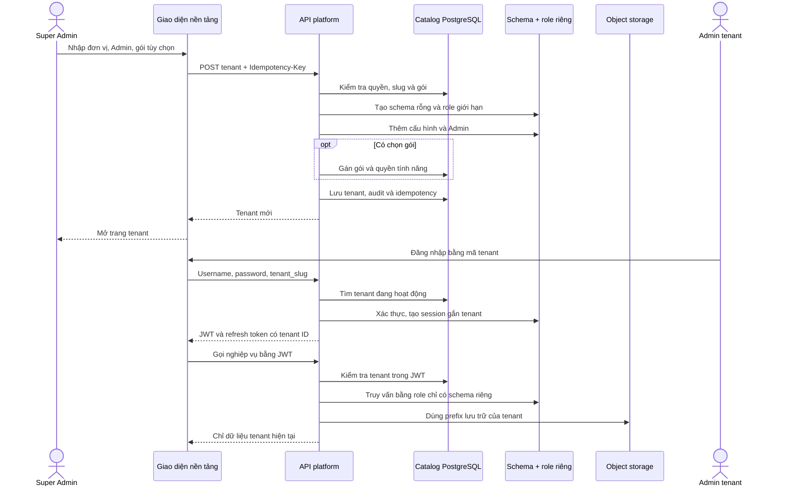

# Thêm tenant và đăng nhập

Chỉ Super Admin có quyền `platform.tenants.manage` mới thấy nút **Thêm tenant**. Biểu mẫu tạo tenant, Admin đầu tiên và có thể gán gói ngay. Nếu không gán gói, Admin đăng nhập được nhưng nghiệp vụ vẫn khóa tới khi gán gói có hiệu lực.

Mã tenant được dùng khi đăng nhập. Hệ thống tự sinh vùng dữ liệu PostgreSQL và role kết nối riêng, gắn session/token với tenant, và lưu tệp theo prefix riêng. Schema, password DB và khóa lưu trữ không xuất hiện trong giao diện.

Tạo schema, Admin, đăng ký, audit và idempotency được thực hiện trong cùng transaction. Migration 017 chỉ thêm metadata và quyền kết nối; không tạo tenant hoặc gói mẫu và không chuyển dữ liệu legacy.

Kiểm thử PostgreSQL đã tạo hai tenant có cùng username và ID nội bộ, xác nhận role tenant này không đọc được schema tenant kia và không thể `SET ROLE` sang database owner. Test cũng xác nhận idempotency, gói được gán lúc tạo giới hạn đúng tính năng, migration chạy lặp và dọn sạch schema/role. Test lưu trữ xác nhận prefix tenant và chặn traversal. Chưa chạy đăng nhập trình duyệt qua hai tenant trên môi trường local.
